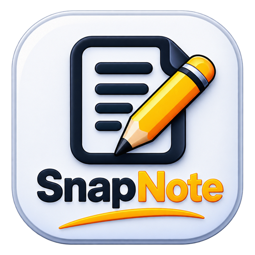
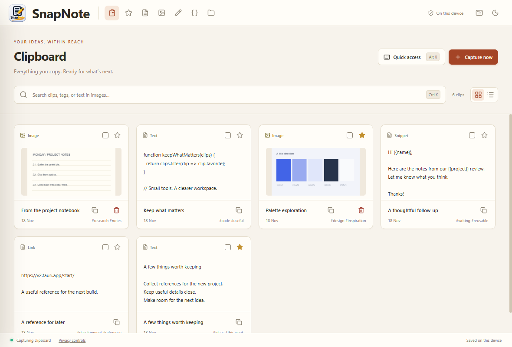

<p align="center">
  <a href="https://waqar-743.github.io/SnapNote/">
    <picture>
      <source media="(prefers-color-scheme: dark)" srcset="SnapNote-icon-dark.png">
      
    </picture>
  </a>
</p>

<h1 align="center">SnapNote</h1>

<p align="center">
  <strong>A private, local-first clipboard manager and notes workspace for Windows 10 &amp; 11.</strong><br>
  Everything you copy — text, links, images, snippets, and rich notes — searchable in a second with <code>Alt + X</code>, strictly on your own PC.
</p>

<p align="center">
  <a href="https://waqar-743.github.io/SnapNote/"></a>
  <a href="https://github.com/Waqar-743/SnapNote/releases/latest"></a>
  <a href="https://github.com/Waqar-743/SnapNote/actions"></a>
  <a href="https://waqar-743.github.io/SnapNote/#privacy"></a>
</p>

<p align="center">
  <a href="https://waqar-743.github.io/SnapNote/#download">Download for Windows</a> ·
  <a href="https://waqar-743.github.io/SnapNote/#features">Features</a> ·
  <a href="https://waqar-743.github.io/SnapNote/#quick-access">Alt+X Quick Access</a> ·
  <a href="https://waqar-743.github.io/SnapNote/#privacy">Privacy</a> ·
  <a href="https://waqar-743.github.io/SnapNote/#faq">FAQ</a>
</p>

<br>

<p align="center">
  <a href="https://waqar-743.github.io/SnapNote/#screenshots">
    <picture>
      <source media="(prefers-color-scheme: dark)" srcset="docs/product/workspace-dark.png">
      
    </picture>
  </a>
</p>

---

## Why SnapNote?

You copy a useful command, a paragraph from an article, a screenshot, or a message you'll need again in ten minutes — and the standard clipboard quietly overwrites it.

**SnapNote** keeps everything you copy in one fast, calm Windows workspace without ever sending a byte to the cloud. No account, no login, no telemetry — just your clipboard history, reusable snippets, image tools, and rich notes living securely on your own device.

## Key Features

- **Unified Frameless Desktop Interface** — Single custom title bar with integrated Minimize, Maximize/Restore, and Close controls, drag/double-click maximize, 1-click **Keep on top** pin toggle, custom theme-matched dialogs, and warm light & dark modes.
- **Floating `Alt + X` Quick Access** — Press `Alt + X` from any Windows app to pop up a compact searchable clipboard window. Press it again to hide it back to the system tray.
- **Searchable Clipboard History** — Automatically captures, deduplicates, and indexes text, links, and images locally. Every text, link, snippet, and image card includes 1-click **Copy** confirmation and direct **Delete**, plus multi-select bulk copy and bulk delete.
- **Folders, Sessions & Favorites** — Park long-term projects in folders, group research into sessions, and star favorites so clearing history always preserves what matters.
- **Reusable Snippet Templates** — Turn recurring replies or commands into templates with `{{variables}}`; SnapNote prompts for each variable in a clean modal while keeping the original template untouched.
- **Rich-Text Notes Editor** — Built on [TipTap](https://tiptap.dev/) with headings, lists, task checklists, blockquotes, code blocks, undo/redo, and direct image paste with inline OCR and undoable image removal.
- **Built-In Image Tools & Offline OCR** — Crop and annotate screenshots, pin reference images above other windows, and extract searchable text locally using optional [Tesseract OCR](https://github.com/tesseract-ocr/tesseract).
- **Optional AES-256 Vault & Encrypted Backups** — Lock the local workspace at rest with AES-256-GCM + PBKDF2-SHA256, and export or merge-import plain or password-encrypted JSON backups anytime.

## Download for Windows

Prebuilt, self-contained **Windows 10 & 11 (x64)** installers are compiled and validated automatically by the [Windows build pipeline](https://github.com/Waqar-743/SnapNote/actions) and also available from the [SnapNote Download Hub](https://waqar-743.github.io/SnapNote/#download):

| Installer | Type | Notes |
| --- | --- | --- |
| [`SnapNote_1.6.0_x64_en-US.msi`](https://github.com/Waqar-743/SnapNote/releases/download/v1.6.0/SnapNote_1.6.0_x64_en-US.msi) | MSI installer | **Recommended** — clean standard Windows install |
| [`SnapNote_1.6.0_x64-setup.exe`](https://github.com/Waqar-743/SnapNote/releases/download/v1.6.0/SnapNote_1.6.0_x64-setup.exe) | NSIS executable | Standalone setup wizard |
| [`SnapNote_1.6.0_SHA256SUMS.txt`](https://github.com/Waqar-743/SnapNote/releases/download/v1.6.0/SnapNote_1.6.0_SHA256SUMS.txt) | SHA-256 checksums | Verify downloads via PowerShell `Get-FileHash` |

> **Zero extra runtimes:** The C runtime is statically linked, so SnapNote runs on a fresh Windows 10/11 machine without installing Visual C++ Redistributable. Because indie builds are unsigned, Windows SmartScreen may ask for confirmation on first install — check the [latest release](https://github.com/Waqar-743/SnapNote/releases/latest) checksums anytime.

## Keyboard Shortcuts

| Shortcut | Action |
| --- | --- |
| `Alt + X` | Show / hide floating Quick Access window |
| `Ctrl + Alt + C` | Capture current clipboard into the active rich note |
| `Ctrl + Alt + O` | Bring SnapNote to the foreground |
| `Ctrl + K` | Focus instant clip search |
| `Ctrl + B` / `I` / `U` | Bold / italic / underline in notes |
| `Ctrl + Shift + X` / `H` | Strikethrough / highlight in notes |
| `Ctrl + Z` / `Ctrl + Shift + Z` | Undo / redo in notes |
| `Escape` | Clear search or close active dialog, drawer, or detail pane |

*(On macOS development builds, use `Command` in place of `Ctrl`. Reserved global shortcuts are surfaced gracefully without blocking startup.)*

## Privacy & Local Storage

SnapNote is **local-first by design** — see the full pledge on the [SnapNote Privacy page](https://waqar-743.github.io/SnapNote/#privacy):

- **Zero accounts, zero servers, zero telemetry.** SnapNote works completely offline and never uploads clips, notes, or screenshots.
- **Transactional local storage.** Workspace data lives inside IndexedDB within the app's device profile (`come.codespace.snapnote`), preserving legacy note migration and recovery safety.
- **Optional AES-256-GCM encryption.** Enabling vault encryption rewrites stored data with AES-256-GCM and PBKDF2-SHA256, then removes legacy plaintext copies after confirmation. Locking immediately pauses capture and closes pinned image windows.
- **Local-only OCR.** Optional screenshot text extraction runs entirely on your PC via a local Tesseract installation.

## Build From Source

Built with [Tauri v2](https://v2.tauri.app/), Rust, React 19, TypeScript, and Vite.

Prerequisites: Node 20.19+ (or Node 22/24), stable Rust, and the [Tauri v2 prerequisites](https://v2.tauri.app/start/prerequisites/). On Windows, installer builds require Visual Studio C++ Build Tools and WebView2; optional OCR requires Tesseract on your `PATH`.

Run commands inside `snapnote/`:

```bash
npm ci
npm run tauri dev
```

Validation & production build commands:

```bash
npm test
npm run format:check
npm run build
cargo test --manifest-path src-tauri/Cargo.toml --locked
npm run tauri build
```

## Links & Documentation

- **Official Website:** [waqar-743.github.io/SnapNote](https://waqar-743.github.io/SnapNote/) ([website source & preview](website/README.md))
- **Releases & Installers:** [GitHub Releases](https://github.com/Waqar-743/SnapNote/releases)
- **Desktop User Guide:** [docs/DESKTOP-GUIDE.md](docs/DESKTOP-GUIDE.md)
- **Architecture Strategy:** [docs/DESKTOP-STRATEGY.md](docs/DESKTOP-STRATEGY.md)
- **Project Status:** [docs/PROJECT-STATUS.md](docs/PROJECT-STATUS.md)
- **Automated Validation Evidence:** [docs/testing/README.md](docs/testing/README.md)
- **Author:** [Waqar Ahmed (@Waqar-743)](https://github.com/Waqar-743)
