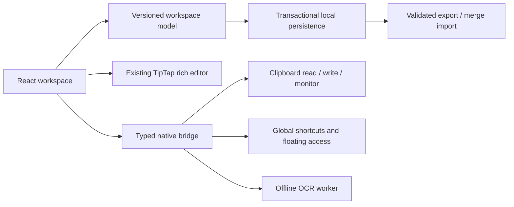

# SnapNote desktop evolution

## Direction and order

The owner selected concept **A — The Mentor** on 2026-10-15. The three original six-pose boards and their exact prompts are in `brand/concepts/`. Concept A is the reference, not yet a finished logo or production asset pack. Preserve its white fur, dark suit, glasses, pointer, and calm adult proportions in later derivatives.

Work order: mascot concepts → inspect and plan → desktop implementation and native validation → website. The owner confirmed there is no existing website and authorized building it from scratch on a separate branch after desktop completion. Windows is the primary release target. Website claims must reflect verified app behavior.

## Inspected baseline

All tracked source, configuration, documentation, and workflow files were reviewed. The lockfiles describe the existing dependency trees; binary logos/icons were inventoried. There are no repository agent instructions, existing tests, or website sources.

- React 19 / TypeScript / Vite 7, Tailwind 3, Lucide, TipTap 2 and its existing formatting/image/task extensions.
- Tauri 2 and Rust; clipboard-manager, global-shortcut, opener, image and rusty-tesseract crates.
- `src/App.tsx` owns the complete UI, editor instances, theme, note persistence, OCR node view and event subscription.
- `src-tauri/src/main.rs` owns clipboard reads, two global shortcuts and synchronous OCR. `lib.rs` is a stub.
- Legacy data: `snapnote-tabs`, `snapnote-active-tab`, `snapnote-theme` in WebView localStorage. Keep the application identifier `come.codespace.snapnote` unchanged so the existing WebView data directory remains reachable.
- Existing functionality to preserve: multiple rich text notes, create/rename/close tabs, all formatting and task lists, undo/redo, image paste, OCR, theme, capture-to-active-note and show-window shortcuts.

## Findings

| Priority | Finding | Consequence / correction |
| --- | --- | --- |
| High | Clipboard text passed to `insertContent(string)` | Literal text can become markup; insert structured text nodes and retain whitespace. |
| High | Every keystroke rewrites every note synchronously to localStorage | UI stalls, quota failures and lost edits; use asynchronous transactional storage with visible save failures and recovery. |
| High | OCR uses a single shared temporary path | Concurrent requests can overwrite each other; use a unique automatically cleaned temporary file or in-memory image. |
| High | OCR JS argument `base64_data` conflicts with Tauri's default camelCase | Use consistent typed camelCase IPC. |
| High | Shortcut registration propagates errors from setup | A key conflict can prevent launch; report unavailable shortcuts while retaining the app. |
| Medium | Text is trimmed at capture | Code and intentional indentation are damaged; preserve source bytes. |
| Medium | Large clipboard PNGs are written to temp, reread and never deleted | Sensitive data and disk growth; remove redundant temp copies. |
| Medium | No automatic history, duplicate suppression, copy-back or search | Clipboard workspace needs a dedicated history model and native read/write boundary. |
| Medium | Event subscription recreated on tab changes; async teardown races | Subscribe once with cleanup that handles late registration. |
| Medium | One editor instance for every tab | Unnecessary memory; mount the active editor and persist note content separately. |
| Medium | Remote font import and disabled CSP | Offline rendering and privacy gaps; system font stack and restrictive production CSP. |
| Medium | Unvalidated saved/imported state and silent parse failures | Do not overwrite corrupt data; validate imports and expose recovery/export. |
| Medium | Fixed narrow utility layout with dense toolbar | Responsive workspace with progressive disclosure and keyboard-visible controls. |

## Architecture

Retain the existing stack, application identity, TipTap document format, dependencies where useful, and native clipboard/OCR integrations. Refactor the editor into a component; introduce a small versioned domain model, storage adapter, native bridge, and focused workspace components. Avoid a new framework or backend service.

Entities: clips (text/image, title, tags, folder/session, favorite, timestamp, OCR text), notes (legacy HTML preserved), folders, sessions and privacy settings. Duplicate identity uses exact content and content type. Search covers title, text, tags, OCR and note text. Automatic history is separate from deliberate capture into a note. Favorites and organized items are protected from normal retention pruning.

Native operations must run outside the UI thread, return actionable errors, cap input sizes and survive transient clipboard failures. Automatic capture starts only after preferences load and the user enables it. Pause capture immediately when locked. Preserve the existing shortcuts; add Alt+S quick access. Never claim successful copy/save/OCR until the operation succeeds.

## Interaction and visual design

- Sidebar: All clips, Favorites, Text, Images, Notes, Snippets, folders and sessions. Visible capture state and privacy/settings entry.
- Main area: clear title, search, filters, clip cards/list, empty states and small secondary actions. Detail pane for selection, organizing and image actions.
- Notes preserve the existing rich editor with all tools, moved out of the default clipboard workflow. Multi-select text clips for combined copying and session grouping.
- A restrained slate/blue palette, white surfaces, soft borders, 8px spacing scale, system typography and Lucide icons. Match dark mode and adapt below desktop widths.
- Put optional functions in context or settings. Use meaningful labels, visible keyboard focus, accessible dialogs and status announcements. No decorative mascot in every control; use the selected wolf sparingly in later product guidance.

## Delivery phases and acceptance

1. **Foundation and compatibility:** migrate legacy notes without deleting the original; asynchronous persistence; safe literal text insertion; OCR and lifecycle fixes; error UI. Existing notes, formatting, themes and capture shortcuts must survive.
2. **Clipboard workspace:** automatic opt-in text/image capture, deduplication, copy-back, search, favorites, tags/folders, sessions, reusable snippets and multi-item text copy. Retention must not discard protected items.
3. **Native workflow and images:** Alt+S quick access, floating/always-on-top access, pin image, crop/annotation and OCR into searchable metadata. Verify text and image round-trips in the actual native app.
4. **Privacy and recovery:** pause, limits, clear history, safe backups/import, storage failure recovery, at-rest protection where implemented. Keep sync optional and disabled; a real sync provider, account lifecycle and conflict policy need a separate implementation and must not be represented as shipping prematurely.
5. **Desktop release gate:** build/run native app; test migration, relaunch persistence, native clipboard text/image, dedupe, hotkeys/conflicts, editor tools, image actions, OCR, backup restore, failures, theme and narrow layout. Record environment limits and untested target platforms explicitly.
6. **Website:** only after the desktop gate; create it on a separate branch, use real tested screenshots/features and selected mascot assets. No site has been started.

## Validation environment

Initial container: Node/npm available; no installed frontend dependencies, Rust toolchain, GTK/WebKit development libraries, OCR binary or virtual display. Install these prerequisites before making native-test claims. Windows and macOS require their own native validation even after Linux checks pass.

## Primary implementation references

- [Tauri clipboard plugin](https://v2.tauri.app/plugin/clipboard/)
- [Tauri shortcut API and conflict behavior](https://v2.tauri.app/reference/javascript/global-shortcut/)
- [Tauri native WebDriver test setup](https://v2.tauri.app/develop/tests/webdriver/manual-setup/)

## Implemented validation pass

Desktop version is now 1.2.0 to support upgrading existing installations; the identifier is unchanged. The selected A mascot and all original concepts are preserved. The architecture now has separate domain, storage, backup/encryption, rich-editor, and image-editing modules. The UI has been redesigned around clipboard history while retaining rich notes. TipTap was migrated to patched v3 packages, compatible dependencies were updated, and the unused Tailwind build layer and remote font were removed; npm reports zero advisories for the resulting dependency tree.

The initial pass completed eight TypeScript tests, three Rust helper tests, and twenty actual native Linux workflow checks. Native testing found and fixed editor initialization timing and temporary WebKit image paste URLs. The recovery pass below expands this coverage and completes the primary Windows gate. See `testing/README.md` for current evidence and remaining scope.

## Recovery pass, 2026-10-16

The implementation was recovered from Git and revalidated rather than rebuilt. Local validation now passes ten TypeScript tests, four Rust tests and twenty-four native Linux checks. Additional fixes preserve note images exposed only through the parsed paste slice, close private image pins on lock, reject over-capacity imports, restore missing metadata on duplicate imports, and include image dimensions in duplicate identity. An aborted encrypted storage transaction preserves committed data and subsequent saves recover.

Windows testing exposed shell-glob expansion, source line endings and a Tauri API/core version mismatch; these are fixed. Real runtime tests then found a synchronous pinned-window deadlock and inconsistent shared-profile browser options; both are fixed. All 24 native Windows checks and the final MSI/EXE installer builds pass in run `38856921850`, commit `20a3214`. The website stage can now proceed; see `PROJECT-STATUS.md` for delivery status.
